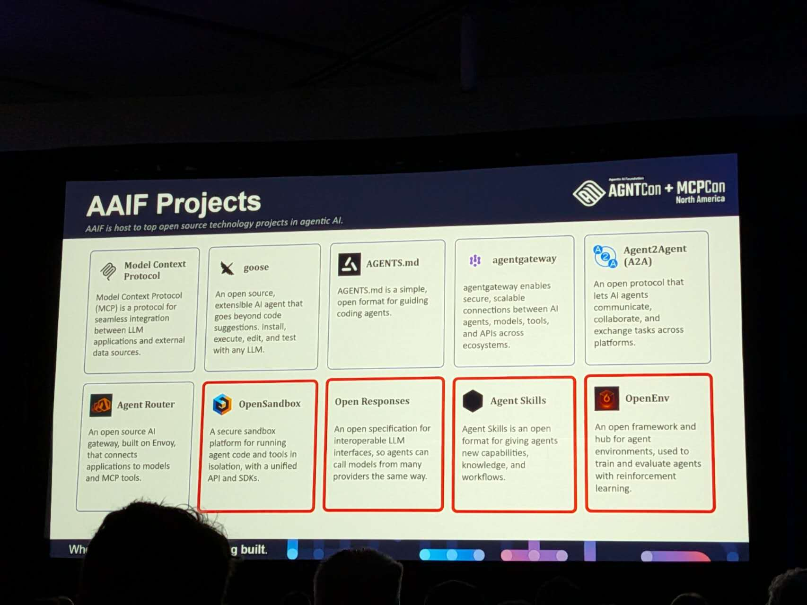
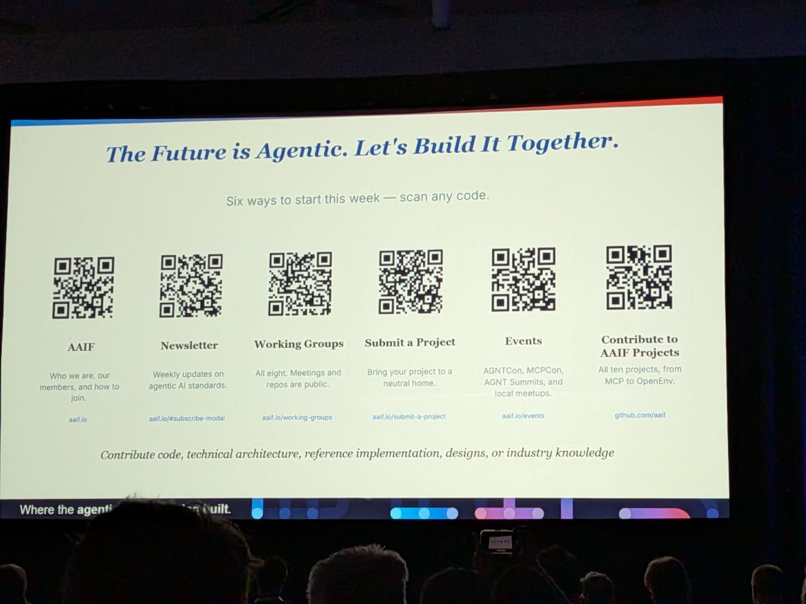
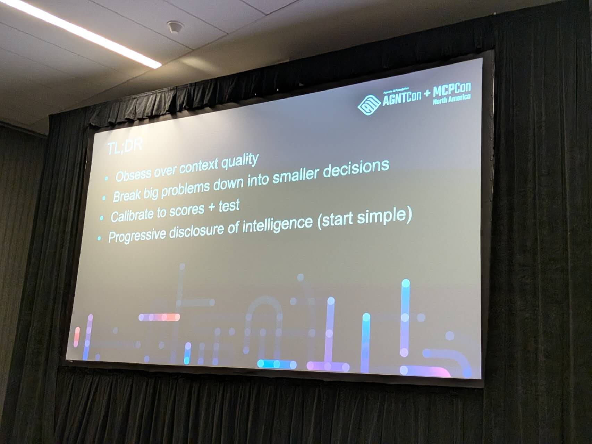

# AI Agent Conference 2026

Most of the talks in this conference couldn't help me much. But talking with those senior or principle engineers are fun! Learned lots of insights from them! Then they got interested in what I'm doing, including my side projects! 

* https://open-sandbox.ai/
* Agent Skills: https://github.com/addyosmani/agent-skills
  * Create your own skill if the repo doesn't have the template to support your reusable workflow for your coding agent, describing your **steps, rules, and expected output** in `SKILL.md`.

### Tips to use Jev from Langchain

* Personal notes
  * Jev's confidence score is NOT the probability of the answer. It means "How strongly does this distribution favor one answer?"
  * Calibration is checked across groups of predictions by comparing probabilities with observed frequencies.
    * For example, 1,000 different messages that Jev assigns approximately 80% probability of belonging to Billing:
      * Around 800 actually belong to Billing → well calibrated around 80%.
      * Only 600 belong to Billing → overconfident.
      * Around 950 belong to Billing → underconfident.
* Cisco & Splunk Agtns Observability
  * Markdown & Knowledge Graph as the context (working in progress...)
  * Cost, usage, latency are always must-have metrics
  * Allow **user-AI interaction UI** to allow users ask AI to understand the observability dashboard appears to be an important feature, similar to the initiative of AI for BI when I was in Scotiabank
  * **Alerts** initially set based on users' requirements, but they're trying to provide automatic **adaptive** solution to prioritize alerts
  * Human beings to check the root causes of alters using **MCP Server**
    * In the future, they might to have Claude to get access to customers' agents data through MCP server to solve the problems
    * The alterts could be why the agent didn't deliver what's expected, or simply didn't work, didn't meet user's request, etc.
* DevOps
  * AI created much more workload to devops, they need to review much more lines of code without getting much help from AI.
  * But people still spend time to contribute to open sources, and they're interested in what I'm building now
* Obot
  * Obot is an open-source platform for organizations to manage, secure, and govern their AI ecosystems.
  * It allows coding agents (CODEX, CLaude, etc.) to use part of its platform
  * Needs human to review JSON formated data for each incident (no wonder Ops people are busy...)
  * Example
    * Prompt injection that got customers' private data --> Obot's Defense in depth model
      * Provide a list of tools for vulnerability support --> turn off tools to prevent customers' provate data got sent....
        * But, if you turn off the tools to prevent such attacks, why did you provide the tools in in the first place.....
    * The inspector also has **user-AI interaction interface**
      * Able to see: Tools, Prompts, Resources, Chat, MCP Log
      * I actually think Chat can show large amount of data, but it will help the users more by highlighting what's really important to them. For example, highlight the PII data that had been exposed to give the user enough warning 🤔

